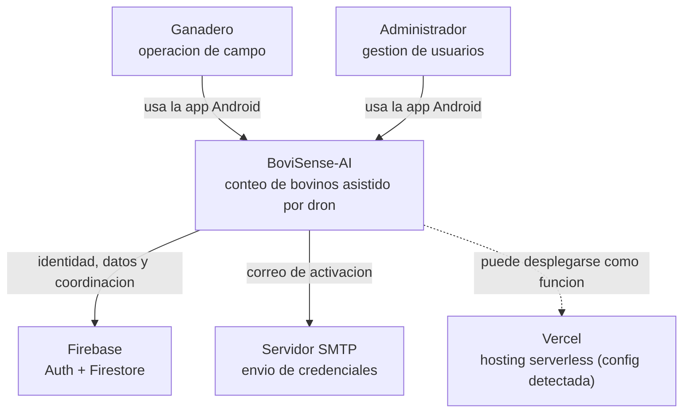
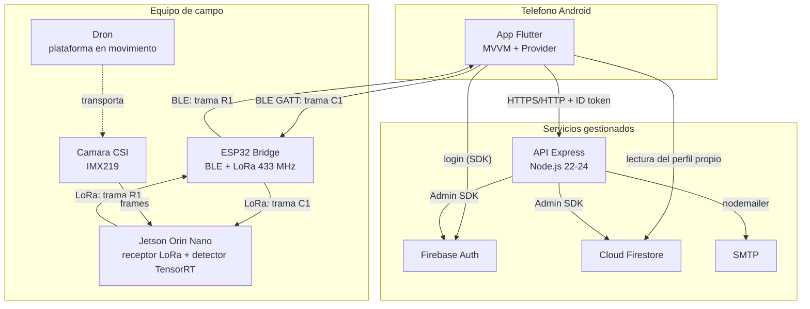
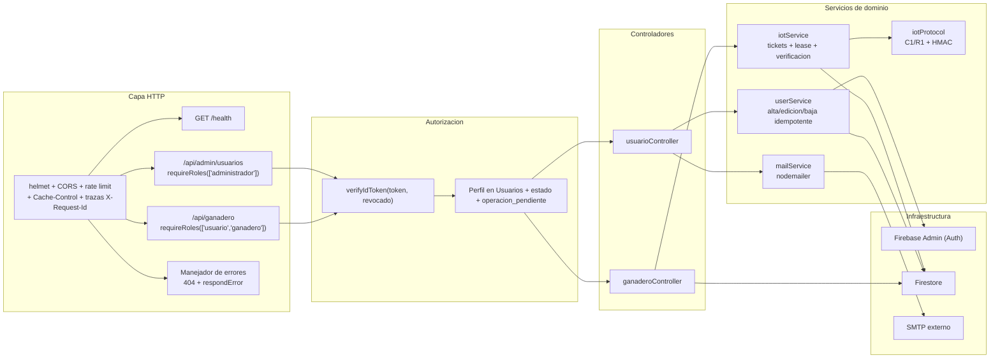
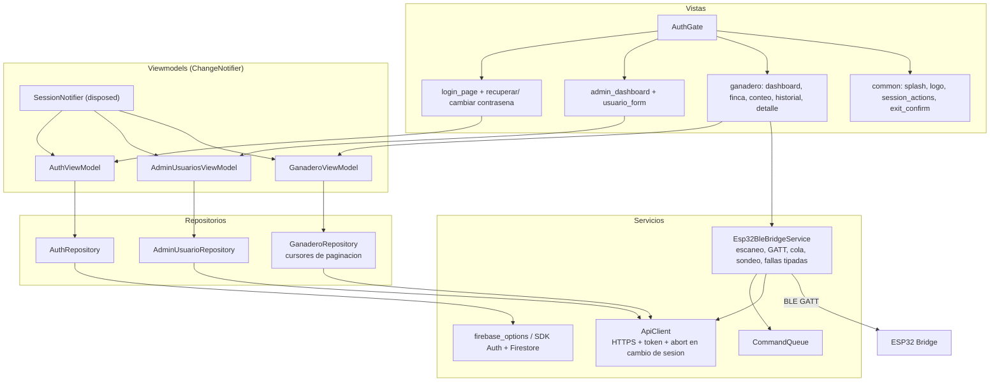
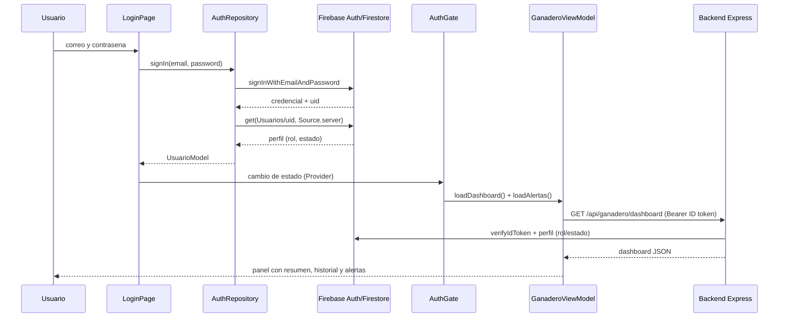
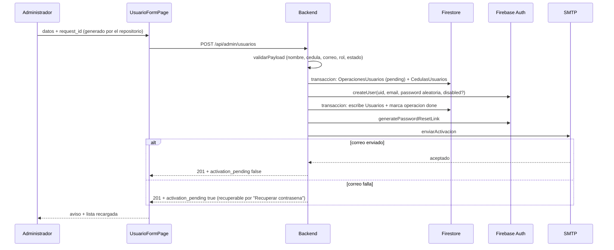
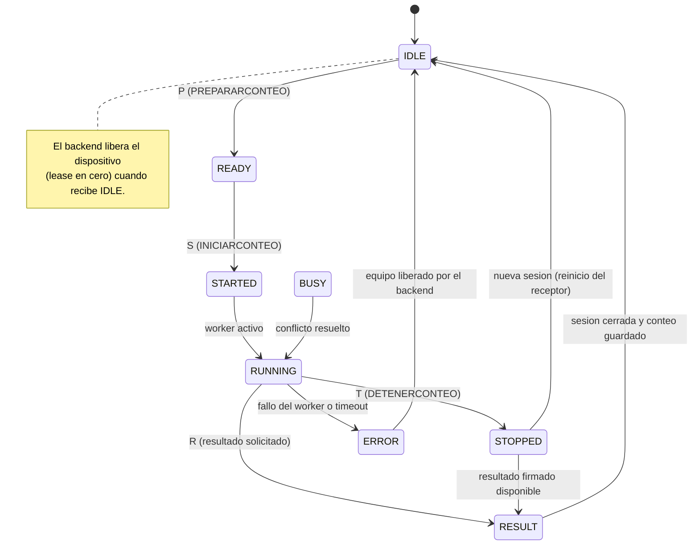
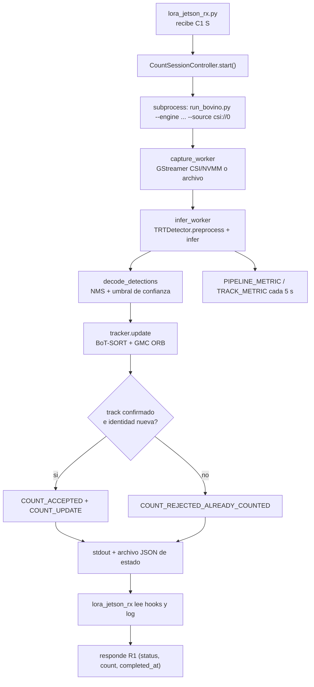
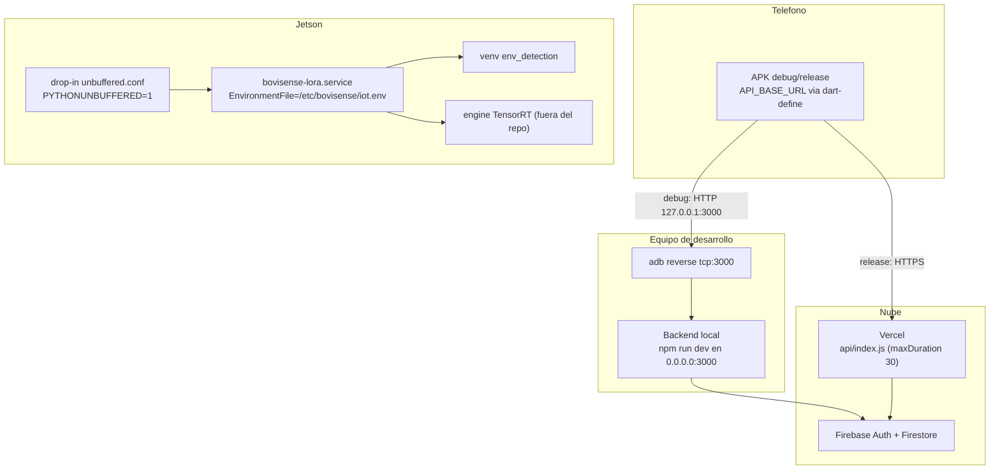

# Diagramas de arquitectura

Diagramas elaborados a partir del código y la configuración reales del
repositorio. Cada diagrama indica su fuente. Renderizables en cualquier visor
compatible con Mermaid (GitHub, GitLab, VS Code, mermaid.live).

## 1. C4 — Nivel 1: contexto del sistema

Fuente: `README.md`, `backend/src/app.js`, `frontend/lib/main.dart`,
`jetson/lora_jetson_rx.py`, `comunicacion-iot/esp32/.../*.ino`.



## 2. C4 — Nivel 2: contenedores

Fuente: `backend/src/app.js:59-60`, `backend/vercel.json`,
`frontend/lib/main.dart:127-160`, `frontend/lib/data/services/esp32_ble_bridge_service.dart`,
`jetson/lora_jetson_rx.py:1318`, `jetson/run_bovino.py:2483`,
`comunicacion-iot/esp32/.../*.ino:31-47`.



## 3. Componentes del backend

Fuente: `backend/src/app.js`, `backend/src/routes/*.js`,
`backend/src/controllers/*.js`, `backend/src/services/*.js`,
`backend/src/middlewares/authMiddleware.js`, `backend/src/utils/*.js`.



## 4. Componentes de la aplicación Flutter

Fuente: `frontend/lib/main.dart`, `frontend/lib/views/`,
`frontend/lib/viewmodels/`, `frontend/lib/data/`.



## 5. Secuencia — inicio de sesión y carga del panel

Fuente: `frontend/lib/views/auth/login_page.dart:34-51`,
`frontend/lib/data/repositories/auth_repository.dart`,
`frontend/lib/views/auth_gate.dart:11-33`,
`frontend/lib/viewmodels/ganadero_view_model.dart:40-55`,
`backend/src/middlewares/authMiddleware.js:13-103`.



## 6. Secuencia — sesión de conteo completa

Fuente: `frontend/lib/data/services/esp32_ble_bridge_service.dart`,
`backend/src/services/iotService.js:11-103`,
`jetson/lora_jetson_rx.py:1318-1345`, `jetson/secure_protocol.py:60-100`,
`backend/src/controllers/ganaderoController.js:329-368`.

```mermaid
sequenceDiagram
  participant APP as App Flutter
  participant API as Backend
  participant ESP as ESP32
  participant JET as Jetson
  participant FS as Firestore

  APP->>API: POST /api/ganadero/iot/comandos {command: INICIARCONTEO}
  API->>FS: transaccion: crea IotSessions + lease en IotDevices
  API-->>APP: frame C1 firmado + request_id + session_id
  APP->>ESP: BLE ~C1...\n (fragmentos de 18 bytes)
  ESP->>JET: LoRa trama C1 completa
  JET->>JET: parse_command (firma, expiracion, sesion)
  JET->>JET: antirreplay SQLite (nueva solicitud)
  JET->>JET: lanza run_bovino.py (worker de deteccion)
  JET-->>ESP: R1|...|STARTED (firmada)
  ESP-->>APP: BLE notificacion con R1
  APP->>API: POST /api/ganadero/iot/respuestas {frame}
  API->>API: responseFrame (HMAC + estados)
  API->>FS: guarda response; actualiza sesion/dispositivo
  API-->>APP: {status: STARTED, session, count}

  loop Cada 4 s mientras corre
    APP->>API: POST /iot/comandos {command: ESTADOCONTEO}
    API-->>APP: C1 (comando Q)
    APP->>ESP: BLE
    ESP->>JET: LoRa
    JET-->>ESP: R1 RUNNING con count parcial
    ESP-->>APP: BLE
    APP->>API: POST /iot/respuestas
    API-->>APP: {status: RUNNING, count}
  end

  APP->>API: POST /iot/comandos {command: DETENERCONTEO}
  API-->>APP: C1 (comando T)
  APP->>ESP: BLE
  ESP->>JET: LoRa
  JET->>JET: detiene worker y firma resultado
  JET-->>ESP: R1 STOPPED con count y completed_at
  ESP-->>APP: BLE
  APP->>API: POST /iot/respuestas
  API-->>APP: {status: STOPPED, count, proof}
  APP->>API: POST /api/ganadero/conteos {session_id, proof}
  API->>FS: crea Conteos + Alertas si hay diferencia
  API-->>APP: 201 conteo guardado
```

## 7. Secuencia — alta de usuario por el administrador

Fuente: `frontend/lib/views/admin/usuario_form_page.dart:65-98`,
`backend/src/controllers/usuarioController.js:45-58`,
`backend/src/services/userService.js:12-108`.



## 8. Máquina de estados de la sesión de conteo

Fuente: `backend/src/services/iotProtocol.js:4-5`,
`jetson/secure_protocol.py:12`, `jetson/lora_jetson_rx.py:985-1040,1132`.



## 9. Flujo interno de detección y tracking en la Jetson

Fuente: `jetson/run_bovino.py` (hilos de captura, inferencia y dibujo),
`jetson/lora_jetson_rx.py` (sesión y lectura de hooks).



## 10. Despliegue

Fuente: `backend/vercel.json`, `backend/api/index.js`,
`frontend/android/app/build.gradle.kts`, `frontend/run_usb.sh`,
`jetson/systemd/unbuffered.conf`, `docs/seguridad-y-despliegue.md`.


