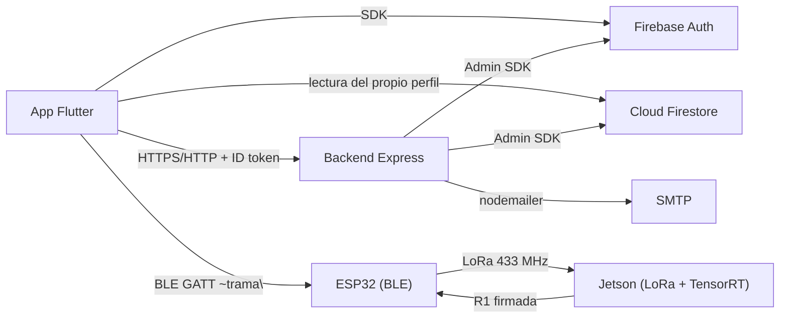

# External Integrations

## Core Sections (Required)

### 1) Integration Inventory

| System | Type (API/DB/Queue/etc) | Purpose | Auth model | Criticality | Evidence |
|--------|---------------------------|---------|------------|-------------|----------|
| Firebase Authentication | Servicio gestionado | Login, cambio y recuperación de contraseña, tokens de sesión | Cuenta de servicio (Admin SDK) en backend; SDK cliente en la app | Alta | `backend/src/config/firebaseAdmin.js:3-5`, `frontend/lib/data/repositories/auth_repository.dart` |
| Cloud Firestore | Base de datos documental | Perfiles, configuración, conteos, alertas, tickets y sesiones IoT | Admin SDK con credenciales de servicio; lectura cliente limitada por reglas | Alta | `firestore.rules:1-14`, `backend/src/controllers/ganaderoController.js:26-36` |
| SMTP | Servicio de correo | Envío del enlace de activación al crear usuario | Usuario/contraseña en variables de entorno | Media (degradable) | `backend/src/services/mailService.js:3-10` |
| Puente ESP32 (BLE) | Dispositivo físico | Transporte de tramas firmadas teléfono → radio | Sin autenticación propia: retransmite tramas opacas | Alta | `frontend/lib/data/services/esp32_ble_bridge_service.dart`, `bridge_hotspot_lora_discovery.ino:31-34` |
| Enlace LoRa 433 MHz | Radio | Transporte ESP32 ↔ Jetson | Firma HMAC de la trama C1/R1 | Alta | `jetson/lora_jetson_rx.py:518-560`, `bridge_hotspot_lora_discovery.ino:39-47` |
| Jetson (receptor + worker) | Proceso en el borde | Ejecuta comandos y produce el conteo | `IOT_SHARED_SECRET` en `/etc/bovisense/iot.env` | Alta | `jetson/secure_protocol.py:15-20`, `AGENTS.md` sección 4 |
| Lanzador de apps del teléfono | Intención de Android | Marcar al soporte y abrir WhatsApp | Ninguna (intents del sistema) | Baja | `frontend/lib/views/auth/login_page.dart:53-80` |
| `BluetoothManager` de Android | Canal de plataforma (`MethodChannel`) | Detectar audífonos/parlantes conectados | Permiso `BLUETOOTH_CONNECT` | Baja (diagnóstico) | `frontend/android/app/src/main/kotlin/com/example/frontend/MainActivity.kt:15-30` |
| Vercel | Plataforma serverless | Ejecutar la API como función | `VERCEL=1` ajusta `trust proxy` | Media | `backend/vercel.json:1-12`, `backend/src/app.js:13` |

### 2) Data Stores

| Store | Role | Access layer | Key risk | Evidence |
|-------|------|--------------|----------|----------|
| Firestore `Usuarios/{uid}` | Perfil y rol | `backend/src/services/userService.js`, lectura cliente del propio perfil | Reglas permiten solo lectura propia y activa; resto por API | `firestore.rules:4-8` |
| Firestore `Usuarios/{uid}/ConfiguracionSistema/general` | Nombre de finca y cantidad esperada | `ganaderoController.getRefs()` | Requerida antes de iniciar conteo | `backend/src/controllers/ganaderoController.js:26-36`, `iotService.js:43` |
| Firestore `Usuarios/{uid}/Conteos` y `/Alertas` | Historial y alertas | `ganaderoController` (con lectura de colecciones heredadas) | Duplicidad con colecciones heredadas de nivel raíz | `backend/src/controllers/ganaderoController.js:127-221` |
| Firestore `IotCommands`, `IotSessions`, `IotDevices` | Tickets, sesiones y lease del dispositivo | `backend/src/services/iotService.js` | Estado de sesión duplicado respecto a la Jetson | `backend/src/services/iotService.js:63,100-102` |
| Firestore `CedulasUsuarios`, `OperacionesUsuarios` | Índice único de cédula y estado de operaciones | `backend/src/services/userService.js:6-8` | Sin limpieza automática de operaciones completadas | `backend/src/services/userService.js:79` |
| SQLite `protocol.sqlite3` (Jetson) | Antirreplay de solicitudes y resultados firmados | `jetson/secure_protocol.py:60-100` | Borrarlo permite reejecutar tramas | `jetson/secure_protocol.py:64-70` |
| Estado en memoria (Jetson) | Sesión viva, worker, tracker, contador | `jetson/lora_jetson_rx.py`, `jetson/run_bovino.py` | Se pierde al reiniciar (causa del incidente de la sección 12 de `AGENTS.md`) | `jetson/lora_jetson_rx.py` (`CountSessionController`) |
| Archivos JSON de estado del worker | Puente receptor ↔ worker | `BOVISENSE_STATUS_FILE`, `BOVISENSE_RESULT_FILE` | Ruta no configurada ⇒ `status_file_error` | `jetson/run_bovino.py:26-28,92-101` |

### 3) Secrets and Credentials Handling

- Fuentes: variables de entorno cargadas desde `backend/.env`
  (`backend/src/app.js:2`), archivo `EnvironmentFile=/etc/bovisense/iot.env` en
  la Jetson (`AGENTS.md`, sección 4) y `frontend/lib/firebase_options.dart`
  para la configuración pública del cliente.
- Verificación de higiene (nombres solamente, sin valores):
  - **No versionados**: `backend/.env` y
    `backend/aplicacion-cabfa-firebase-adminsdk-*.json` están cubiertos por
    `.gitignore:1,4` y `git check-ignore` los confirma.
  - **Sí versionados**: `backend/google-services.json` y
    `frontend/android/app/google-services.json` (`git ls-files`), ambos con la
    configuración pública del proyecto Firebase (id de proyecto, número de
    proyecto y `api_key` de cliente, 3 apariciones cada uno). Son datos de
    cliente por diseño de Firebase, pero conviene decidir explícitamente si se
    mantienen en el repositorio.
  - `backend/.gitignore` raíz incluye `AGENTS.md` **y** ese archivo está
    versionado; la regla no tiene efecto sobre archivos ya rastreados.
- Rotación: `docs/seguridad-y-despliegue.md` indica generar la clave IoT con
  `openssl rand -hex 32` y reiniciar el receptor al rotarla. No hay gestor de
  secretos ni rotación automática.

### 4) Reliability and Failure Behavior

| Mecanismo | Implementado | Evidencia |
|-----------|--------------|-----------|
| Timeout HTTP cliente | 30 s por omisión, configurable | `frontend/lib/data/services/api_client.dart:42,55` |
| Abortar petición si cambia la sesión | Sí (`AbortableRequest` + comparación de `uid`) | `frontend/lib/data/services/api_client.dart:118-146` |
| Timeout de respuesta BLE | 25 s | `frontend/lib/data/services/esp32_ble_bridge_service.dart` (`.timeout(const Duration(seconds: 25))`) |
| Espera de respuesta LoRa en el puente | 22 s | `bridge_hotspot_lora_discovery.ino:47` |
| Reintento del sondeo de conteo | Espera creciente 4/5/8/12 s y sin solapes | `frontend/lib/data/services/esp32_ble_bridge_service.dart` (`_pollDelay`, `_runCountPoll`) |
| Idempotencia de comandos | Ticket por `request_id`; respuesta única por ticket | `backend/src/services/iotService.js:20-28,76` |
| Antirreplay en el borde | SQLite con `requests`/`results` | `jetson/secure_protocol.py:69-82` |
| Reintento del alta de usuario | Huella + `lease_until` de 5 min | `backend/src/services/userService.js:21-30` |
| Límite de tasa | 120 req/min por IP | `backend/src/app.js:18-21` |
| Carga de cuerpo máxima | 16 kb | `backend/src/app.js:22` |
| Degradación sin librería de tracking | Tracker interno con aviso | `jetson/run_bovino.py:1973-1978` |
| Fallback de correo | La cuenta queda recuperable y se informa `activation_pending` | `backend/src/services/userService.js:81-90` |
| Circuit breaker / cola de reintentos | No implementado | — |

### 5) Observability for Integrations

- **Backend**: log de cada petición con `X-Request-Id`, hostname y duración
  (`backend/src/app.js:27-38`); log de dominio por paso en ganadero
  (`backend/src/controllers/ganaderoController.js:109-116`); errores como JSON a
  stderr (`backend/src/utils/validation.js:54`).
- **App**: eventos BLE/API en memoria para la vista de detalles técnicos
  (`esp32_ble_bridge_service.dart`, `_event`) y `debugPrint` del cliente HTTP
  (`api_client.dart`).
- **Jetson**: `TRACK_METRIC`, `INFERENCE_METRIC`, `PIPELINE_METRIC` cada 5 s
  (`jetson/run_bovino.py:2225-2250` aprox.), `TRACK_FINAL` al cerrar
  (`jetson/run_bovino.py`), y log del servicio vía `journalctl`
  (`AGENTS.md`, sección 5).
- **Brechas de visibilidad**: no hay APM, métricas centralizadas, alertas de
  infraestructura ni correlación entre el `request_id` de la app y el log de la
  Jetson (`PENDIENTE DE VERIFICACIÓN`: si se explota el campo `request_id` del
  protocolo para correlacionar en campo).

### 6) Evidence

- `backend/src/config/firebaseAdmin.js`, `backend/src/services/mailService.js`
- `firestore.rules`, `backend/vercel.json`, `backend/api/index.js`
- `frontend/lib/data/services/api_client.dart`, `esp32_ble_bridge_service.dart`
- `jetson/secure_protocol.py`, `jetson/run_bovino.py`, `jetson/lora_jetson_rx.py`
- `frontend/android/app/src/main/kotlin/com/example/frontend/MainActivity.kt`
- `.gitignore`, `git ls-files`, `git check-ignore` (verificación de secretos)

## Extended Sections

### Diagrama de integraciones (Mermaid)

